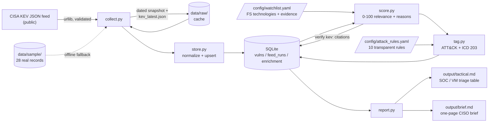

# fin-ti-pipeline

A small, explainable threat-intelligence pipeline that turns the public
**CISA Known Exploited Vulnerabilities (KEV)** catalog into:

- a **tactical triage table** for SOC / vulnerability-management teams, and
- a **one-page executive brief** for a CISO, written in **ICD 203** estimative language,

scored against a watchlist of technologies common in financial institutions and
tagged to **MITRE ATT&CK** with rules you can read in one sitting.

Public data only. No API keys, no secrets. Python 3.11+, with **PyYAML** as the
only third-party dependency.

## Example output

Snapshot from KEV catalog `2026.11.10` (as of 2026-11-10), readable without running anything:

- **[Executive brief for a CISO](examples/brief_2026-11-10.md)**: one page, BLUF,
  ICD 203 key judgments, top 5 priority vulnerabilities, recommended actions.
- **[Tactical triage table](examples/tactical_2026-11-10.md)**: P1/P2 items with
  score, ATT&CK tags, likelihood, confidence and scoring reasons.

---

## Quick start

```bash
pip install -r requirements.txt

python -m fin_ti run --offline     # cached feed (or bundled sample); no network
python -m fin_ti run               # use today's cache, else download
python -m fin_ti run --refresh     # force a fresh download

python -m unittest -v              # 29 tests, no network needed
```

Outputs land in `output/tactical.md` and `output/brief.md`.

Each stage can also be run on its own, which is useful for demos:

| Command | What it does |
|---|---|
| `python -m fin_ti collect [--offline\|--refresh]` | Download or load the KEV JSON; cache raw copy |
| `python -m fin_ti load [--offline\|--refresh]` | Normalize and upsert into SQLite |
| `python -m fin_ti score [--top N]` | Watchlist scoring + watchlist citation check |
| `python -m fin_ti tag [--top N]` | ATT&CK tags + ICD 203 likelihood/confidence |
| `python -m fin_ti report [--limit N]` | Write both Markdown reports |

---

## Architecture



Design principles:

- **Offline-first.** Every download is cached (dated snapshot + `kev_latest.json`).
  A committed 28-record sample of real KEV entries guarantees the demo runs anywhere.
- **Facts and judgments are kept apart.** `vulns` holds CISA's data unchanged in
  meaning; `enrichment` holds our score, tags and estimates.
- **Every output number is traceable.** Reports are rendered from SQL queries,
  not free text. Every score point carries a reason string, and every ATT&CK tag
  records the rule and condition that fired.
- **Reproducible.** "Recency" is measured from the feed's release date, not the
  wall clock, so the same snapshot always produces the same brief.

---

## Method

### 1. Relevance score (0-100), `fin_ti/score.py`

| Factor | Points |
|---|---|
| Watchlist **product** match | +15 to +40 (entry weight) |
| Watchlist **vendor-only** match | +10 |
| Product is internet-facing | +15 |
| CISA: known ransomware campaign use | +25 |
| Added to KEV within 30 / 90 days of feed date | +20 / +10 |

Priority bands: **P1** ≥ 70, **P2** ≥ 45, **P3** ≥ 25, **P4** otherwise.
Matching is case-insensitive and whole-word, so "ISE" does not match "Enterprise".
Only the strongest watchlist hit counts, so overlapping entries are never double-counted.

KEV due dates (BOD 22-01) are deliberately **not** scored. They bind US federal
agencies, not banks, and almost every old entry is overdue, so the factor would
reward age rather than urgency.

### 2. ATT&CK tagging, `config/attack_rules.yaml`

Ten rules map to T1190, T1133, T1059, T1068, T1203, T1189, T1212, T1505.003,
T1210 and T1486. A rule fires on any of: a CWE ID, a keyword in the CVE
name or description, the product name, the watchlist category, the
internet-facing flag, or the ransomware flag. Each tag is labeled:

- **evidence**: the CVE record's own text supports it (CWE or keyword), shown as `T1059*` in the table;
- **inference**: implied by what the product is (e.g. a VPN implies T1133).

Tags describe the technique that exploiting the vulnerability plausibly enables,
**not** observed adversary behavior. Two false positives found on real data are
fixed and covered by tests: "RDP Proxy" in a Citrix description triggered T1210,
and the generic endpoint category put every Windows privilege-escalation bug
under T1203.

### 3. ICD 203 likelihood and confidence, `fin_ti/tag.py`

Likelihood and confidence are reported separately, as ICD 203 requires.

**Likelihood** answers a fixed, stated question. Per CVE (tactical table):
*"How likely is it that threat actors will attempt to exploit this vulnerability
against financial-sector organizations in the next 90 days?"* The brief asks the
same question about **this category of vulnerability**.

| Score | ICD 203 term |
|---|---|
| ≥ 80 | very likely (80-95%) |
| ≥ 65 | likely (55-80%) |
| ≥ 45 | roughly even chance (45-55%) |
| ≥ 25 | unlikely (20-45%) |
| ≥ 10 | very unlikely (05-20%) |
| < 10 | almost no chance (01-05%) |

"Almost certain" is intentionally unreachable: a rules engine without sector
telemetry should not claim it.

**Confidence** counts independent attributes: (a) a product-level watchlist match,
(b) CISA-reported ransomware use, (c) at least one ATT&CK tag grounded in the CVE
text. 3 = high, 2 = moderate, 0-1 = low. In the brief, the ransomware judgment is
capped at **moderate** because all of its attributes come from one source (KEV).

---

## Watchlist provenance

**The choice of products and their weights in `config/watchlist.yaml` is analyst
judgment.** It has not been validated against member inventories, surveys, or
internet-exposure data, and the brief says so. Each entry declares
`prevalence: analyst-judgment` and carries:

- `evidence`: KEV CVE IDs (`kev:CVE-…`) showing the product family is actively
  exploited. These are **machine-checked** on every `score`/`run`. Each cited CVE
  must exist in the loaded KEV data **and** match its own entry at product level.
  This check caught two real matching gaps, "Log4j" vs KEV's "Log4j2" and Cleo's
  "Multiple Products", which had silently downgraded Log4Shell and the Cleo CVEs to
  vendor-only matches.
- `advisories`: optional CISA advisory URLs (AA23-325A, AA23-158A, AA24-060B).
  These are **not** auto-verified because the tool works offline; re-check them before external use.
- `rationale`: a one-line judgment of why the product matters to financial institutions.

Evidence shows that a product **is exploited**. It does not show that financial
institutions **run** it. To validate prevalence:

1. **Member technology profiles**: FS-ISAC member surveys or shared data.
2. **Own-estate inventory**: reconcile against the CMDB / EASM asset list.
3. **Internet exposure**: Shodan/Censys counts of each product on FS-sector ASNs.
4. **Incident reporting**: CISA advisories, FS-ISAC reporting, Mandiant M-Trends,
   Verizon DBIR (financial vertical), SEC 8-K Item 1.05 cyber disclosures.

Weights should then be recalibrated from those data rather than set by hand.

---

## Outputs

Each run writes to `output/` (gitignored); committed examples are in [`examples/`](examples/).

- **`output/tactical.md`** ([example](examples/tactical_2026-11-10.md)): P1/P2 items (default limit 100) with score, CVE→NVD link,
  vendor/product, date added, ransomware flag, ATT&CK tags (`*` = evidence),
  likelihood, confidence and scoring reasons. TLP:CLEAR.
- **`output/brief.md`** ([example](examples/brief_2026-11-10.md)): about one page with: BLUF, a "KEV shows exploitation, not
  targeting" caveat, three key judgments (edge exposure, ransomware, endpoints),
  top 5 priority vulnerabilities grouped by product with an explicit tie-break rule, period counts with a
  "not a trend" caveat, recommended actions, and a method note.

---

## Limitations

- **Single source.** KEV confirms exploitation somewhere. It says nothing about
  who was targeted, so it cannot show that financial institutions were targets.
  No sector telemetry, actor attribution or exploit-availability data is used.
- **Watchlist is unvalidated** (see above). Weights and score thresholds are
  hand-set, so rankings are only as good as those judgments.
- **Likelihood is a mapped score, not a calibrated probability.** The ICD 203
  terms communicate ordering consistently. They have not been back-tested against outcomes.
- **Keyword and CWE rules are brittle.** KEV descriptions are short and uneven,
  so ATT&CK tags are conservative and some are inferred from product type.
- **Recency counts KEV addition dates, not exploitation dates.** CISA may add a
  CVE long after exploitation began.
- **Period counts are not a trend.** Three 30-day windows from one snapshot
  describe the present, not a direction.

## Next steps

1. **LLM-assisted drafting with citation verification.** Have an LLM draft the
   brief's narrative from the SQLite rows, require every factual sentence to cite
   a `cve_id` or advisory, then programmatically check each citation exists, that the
   cited record supports the claim (vendor, ransomware flag, dates), and that ICD 203
   terms match the computed band. Reject or flag any unverified sentence. The
   existing `verify_evidence` check for watchlist citations is the seed of this.
2. **Trend analysis.** Dated snapshots are already kept in `data/raw/` and runs are
   logged in `feed_runs`. Add weekly/monthly series of additions by vendor,
   category and ransomware flag, time-to-KEV after CVE publication, and simple
   change detection, with enough periods to call something a trend.
3. **TIP integration.** Export enriched items as STIX 2.1 (Vulnerability +
   attack-pattern relationships, ICD 203 terms in `x_` properties) to MISP or
   OpenCTI, or push via TAXII. Ingest member sightings back to raise confidence.
4. **Enrichment.** EPSS scores (exploitation probability), NVD CVSS/CPE for exact
   product matching, and vendor-advisory scraping of the `notes` URLs.
5. **Validate the watchlist** with the data sources listed under *Watchlist provenance*.

---

## Project layout

```
fin_ti/
  __main__.py   CLI (collect | load | score | tag | report | run)
  collect.py    download, validate, cache, offline fallback
  store.py      SQLite schema, normalization, upsert, feed_runs audit log
  score.py      watchlist matching, 0-100 score, evidence verification
  tag.py        ATT&CK rules engine, ICD 203 likelihood + confidence
  report.py     tactical.md + brief.md rendering
config/
  watchlist.yaml      FS technologies, weights, evidence, rationale
  attack_rules.yaml   ATT&CK mapping rules with rationale
data/
  sample/kev_sample.json   28 real KEV records (committed)
  raw/                     cached downloads (gitignored)
  fin_ti.db                SQLite (gitignored)
examples/                  committed snapshot of brief.md + tactical.md
tests/                     unittest, no network required
```

Data source: [CISA Known Exploited Vulnerabilities Catalog](https://www.cisa.gov/known-exploited-vulnerabilities-catalog) (public).
Outputs are TLP:CLEAR.
